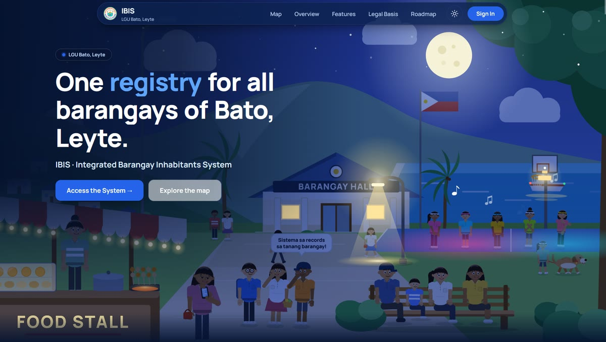
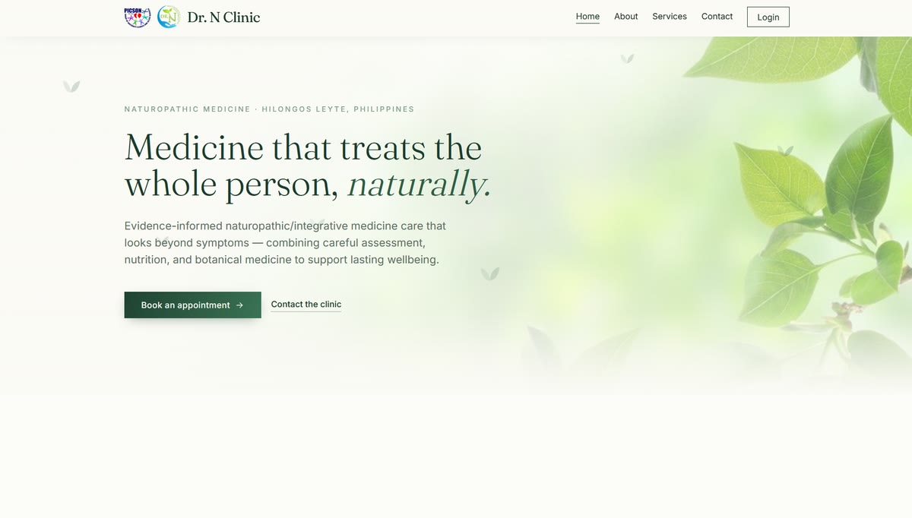
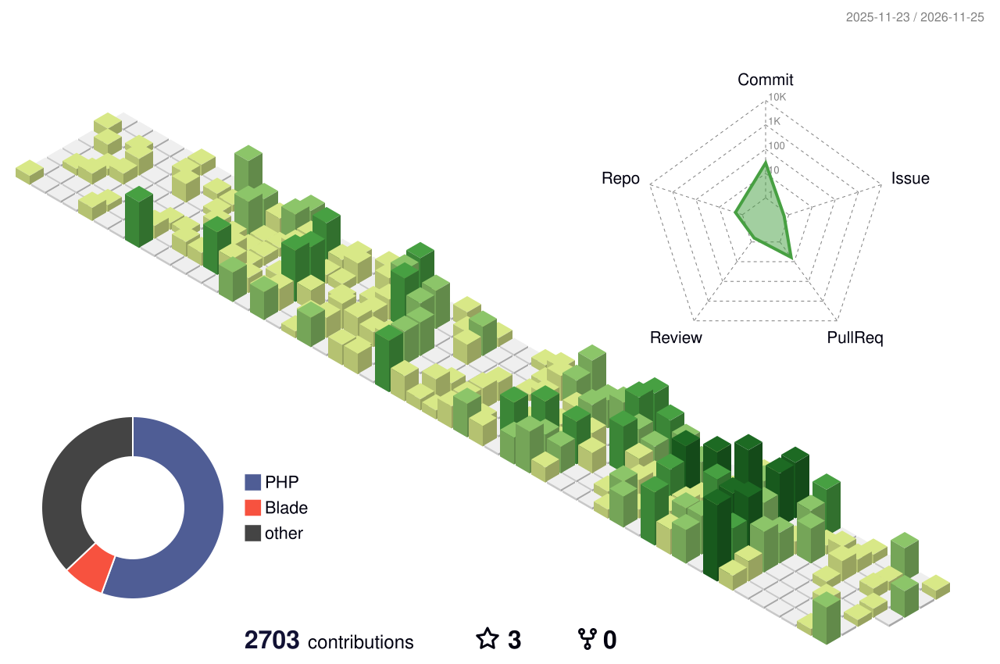

<!-- Profile README for github.com/Laxsnorxx. GitHub Actions generate the snake SVGs (output branch)
     and the 3D calendar (profile-3d-contrib/); don't edit those by hand. Accent color: #FF2D20. -->

<div align="center">

# Reden

**Laravel Full-Stack Developer** at [Creative Dev Labs](https://creativedevlabs.dev)


I build clean, interactive web apps and admin panels with Laravel, Filament, and Livewire.

[**Portfolio**](https://reden-portfolio.vercel.app) · [Email](mailto:rp.oreiro@gmail.com) · [LinkedIn](https://www.linkedin.com/in/reden-paul-oreiro-123846423) · [GitHub](https://github.com/Laxsnorxx)

<a href="mailto:rp.oreiro@gmail.com"></a>

</div>

## Featured work

<table>
<tr>
<td width="50%" valign="top">

<h3>IBIS</h3>
<p>Integrated Barangay Inhabitants System: puts every barangay's resident records in Bato, Leyte into one registry for the municipal government.</p>
<p><sub>Laravel · Filament · Livewire · Tailwind CSS · React · TypeScript</sub></p>
<p><a href="https://ibis.lgubatoleyte.gov.ph/"><b>Live</b></a></p>
</td>
<td width="50%" valign="top">

<h3>DocN</h3>
<p>Lets patients of Dr. N Clinic, a naturopathic practice in Hilongos, Leyte, book appointments and sign in to a patient portal online.</p>
<p><sub>Laravel · Filament · Livewire · Tailwind CSS</sub></p>
<p><a href="https://docn.picson.online/"><b>Live</b></a></p>
</td>
</tr>
</table>

All projects: [reden-portfolio.vercel.app](https://reden-portfolio.vercel.app)

## About

```php
<?php

class Reden extends Developer
{
    public string $role     = 'Laravel Full-Stack Developer';
    public string $company  = 'Creative Dev Labs';
    public string $location = '🌍 Remote';

    public array $stack = ['PHP', 'Laravel', 'Filament', 'Livewire', 'Tailwind CSS'];
    public array $focus = ['Web Apps', 'Admin Panels', 'Clean & Interactive UI'];

    public function currently(): string
    {
        return 'Turning ☕ into elegant, reactive interfaces';
    }
}
```

**Currently building:** web apps at [Creative Dev Labs](https://creativedevlabs.dev)<br>
**Ask me about:** Laravel, Filament, Livewire, and clean UI

## Stack

**Core:** PHP, Laravel, Filament, Livewire, JavaScript, React, Next.js, Node.js, Tailwind CSS, HTML, CSS

<picture>
  <source media="(prefers-color-scheme: dark)" srcset="https://skillicons.dev/icons?i=php,laravel,javascript,react,nextjs,nodejs,tailwindcss,html,css&theme=dark">
  
</picture><br>
<picture><source media="(prefers-color-scheme: dark)" srcset="https://img.shields.io/badge/Filament-242938?style=for-the-badge&logo=filament&logoColor=white"></picture>
<picture><source media="(prefers-color-scheme: dark)" srcset="https://img.shields.io/badge/Livewire-242938?style=for-the-badge&logo=livewire&logoColor=white"></picture>

**Data:** MySQL, PostgreSQL, Supabase, HeidiSQL

<picture>
  <source media="(prefers-color-scheme: dark)" srcset="https://skillicons.dev/icons?i=mysql,postgresql,supabase&theme=dark">
  
</picture><br>
<picture><source media="(prefers-color-scheme: dark)" srcset="https://img.shields.io/badge/HeidiSQL-242938?style=for-the-badge&logo=mariadbfoundation&logoColor=white"></picture>

**Tooling:** Git, GitHub, DigitalOcean

<picture>
  <source media="(prefers-color-scheme: dark)" srcset="https://skillicons.dev/icons?i=git,github&theme=dark">
  
</picture><br>
<picture><source media="(prefers-color-scheme: dark)" srcset="https://img.shields.io/badge/DigitalOcean-242938?style=for-the-badge&logo=digitalocean&logoColor=white"></picture>

## Activity

<picture>
  <source media="(prefers-color-scheme: dark)" srcset="https://github-readme-stats.vercel.app/api?username=Laxsnorxx&show_icons=true&include_all_commits=true&count_private=true&hide_border=true&bg_color=00000000&title_color=e6edf3&text_color=9198a1&icon_color=9198a1">
  
</picture>
<picture>
  <source media="(prefers-color-scheme: dark)" srcset="https://github-readme-stats.vercel.app/api/top-langs/?username=Laxsnorxx&layout=compact&langs_count=8&hide_border=true&bg_color=00000000&title_color=e6edf3&text_color=9198a1&icon_color=9198a1">
  
</picture>

## Contact

Open to collaboration. Email is the fastest way to reach me.

[**Portfolio**](https://reden-portfolio.vercel.app) · [Email](mailto:rp.oreiro@gmail.com) · [LinkedIn](https://www.linkedin.com/in/reden-paul-oreiro-123846423) · [GitHub](https://github.com/Laxsnorxx)

<details>
<summary>Fun stuff</summary>
<br>

<picture>
  <source media="(prefers-color-scheme: dark)" srcset="https://raw.githubusercontent.com/Laxsnorxx/Laxsnorxx/output/github-contribution-grid-snake-dark.svg">
  
</picture>

<picture>
  <source media="(prefers-color-scheme: dark)" srcset="https://raw.githubusercontent.com/Laxsnorxx/Laxsnorxx/main/profile-3d-contrib/profile-night-view.svg">
  
</picture>

</details>
